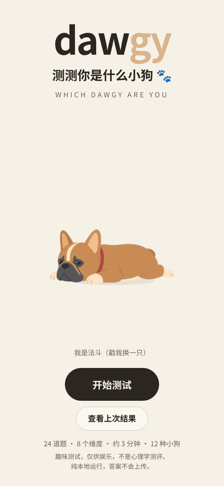
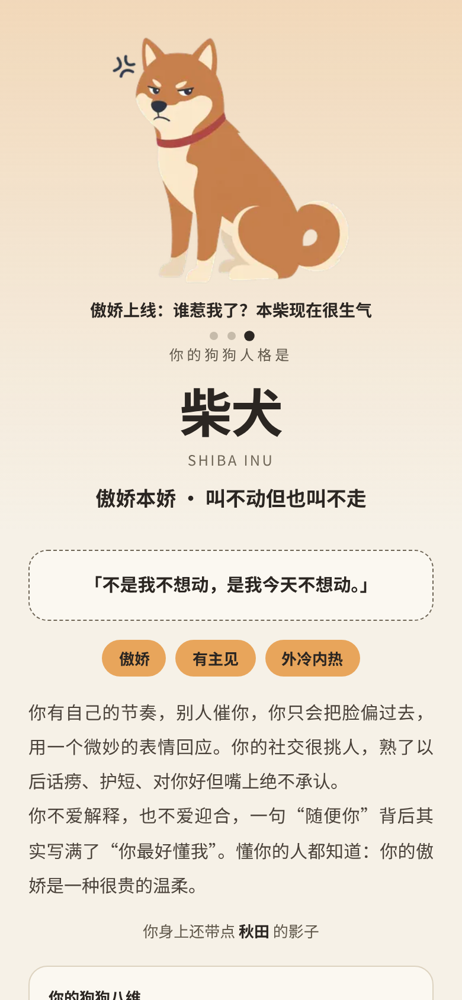
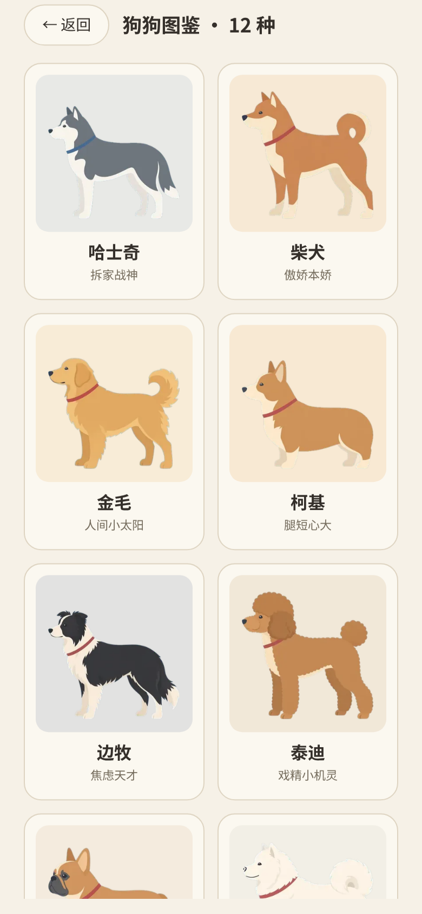
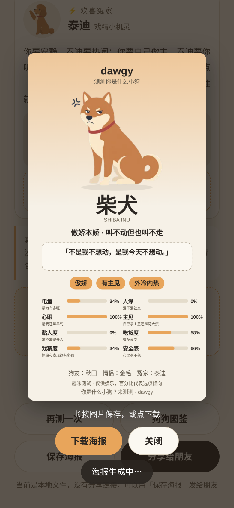

# dawgy · 测测你是什么小狗 🐾

24 道题、8 个维度、12 种小狗的 MBTI 风格趣味测试。**单个 `index.html`，纯前端、离线可用**（零联网请求）。灵感来自 [cati](https://exoticflicker.github.io/cati/)，代码、文案、插画均为原创。

   

## 怎么用
- 直接双击 `index.html`，或丢到任意静态托管（GitHub Pages：仓库 Settings → Pages → 选 `main` 分支根目录即可）。
- 分享链接形如 `index.html#r=shiba&v=<8 维数值>`，朋友点开直接看到同样的结果和八维条（部署到 http(s) 后才有链接；本地文件只复制文案，建议发海报）。
- 移动端优先；手机上「分享给朋友」走系统分享面板，桌面端自动复制。
- **刷新不丢**：你的结果存在 `localStorage`（`dawgy:last`），答到一半刷新会接着答；封面有「查看上次结果」。
- **返回键可用**：基于 hash 路由（`#q3` / `#me` / `#d=corgi` / `#r=…` / `#gallery`），浏览器与手势返回不会直接退出页面；图鉴/关系卡里看别的狗时顶部只提示「你正在看图鉴」，并可「回到我的结果」。
- **选项顺序每次随机**（记录的是原选项下标），避免总选第一个/最后一个造成偏向。

## 八个维度（每维 3 题，共 24 题，题目 3~4 个选项）
| 维度 | 低端 ↔ 高端 |
|---|---|
| E 电量（精力有多旺） | 省电模式 ↔ 永动机 |
| S 人缘（爱不爱社交） | 认生社恐 ↔ 社牛本牛 |
| B 心眼（精明还是单纯） | 憨憨快乐 ↔ 脑瓜转不停 |
| W 主见（自己拿主意还是随大流） | 随和听劝 ↔ 我行我素 |
| C 黏人度（离不离得开人） | 独立自由 ↔ 牛皮糖 |
| F 吃货度（有多爱吃） | 吃饭是任务 ↔ 干饭王 |
| D 戏精度（情绪和表现欲有多强） | 低调内敛 ↔ 自带舞台 |
| A 安全感（心里稳不稳） | 敏感易焦虑 ↔ 稳如泰山 |

## 12 种结果
哈士奇 · 柴犬 · 金毛 · 柯基 · 边牧 · 泰迪 · 法斗 · 萨摩耶 · 博美 · 拉布拉多 · 秋田 · 德牧（见 `dogs_sheet.png`）。每种都有：梗味人设、一句话座右铭、标签、真实狗设冷知识、一句暖心结语、3 个姿势的插画（站 / 坐趴 / 名场面，点结果页主图切换）、八维条形图，以及 **最佳狗友 / 最佳情侣 / 欢喜冤家** 三张关系卡（各含一段分析 + 一个小情景 + 一句 ta 想对你说的话）。

## 计分
1. 每题选项有分值（3 选项 0/1/2；4 选项 0/0.7/1.3/2）；同维 3 题求和后归一到 0~1。
2. 以 0.5 为中心乘 `STRETCH = 1.6` 拉伸（避免所有人都落在中间），夹到 [0,1]。
3. 与 12 个原型（`DOGS[x].p`，8 维坐标）算欧氏距离，最近者为结果，第二近为「身上还带点 xx 的影子」。

原型坐标经过优化，使 12 种结果分布均衡，并且**每种狗的典型八维都有强有弱**（至少 2 维 ≥75%、至少 2 维 ≤25%，由 e2e 校验）。2 万次模拟（`tools/sim_final.js`）：

| 模型 | 最小 ~ 最大占比 |
|---|---|
| 潜在性格模型（含噪声 0.8） | 7.4% ~ 9.2%（理想 8.33%） |
| 潜在性格模型（噪声 1.1，换随机种子） | 7.5% ~ 9.3% |
| 纯随机乱选（不现实，偏向中间性格） | 6.9% ~ 9.7% |

## 插画与姿势
- 12 只小狗 × 3 个姿势 = 36 张扁平矢量风插画（侧身、暖色、彩色项圈、无描边），透明底 webp（320×320，共约 430KB），放在 `img/<key>_0/1/2.webp`；总览见 `poses_sheet.png`。姿势 0 = 站，1 = 坐 / 趴，2 = 名场面（哈士奇啃抱枕、柴犬生闷气、金毛叼球、柯基狂奔、法斗肚皮朝天睡……）。
- 用在哪：封面（随机姿势，点一下换狗换姿势）、答题小狗（轮换姿势）、结果页主图（默认名场面，点主图 0→1→2 循环，配姿势文案和小圆点）、关系卡头像（坐 / 趴）、图鉴（站）、海报（当前主图姿势）。
- `index.html` 里以 base64 内嵌，所以单文件即可离线运行，保存海报时 canvas 也不会被跨域污染。呼吸动画用 CSS 实现。
- 重新抠图 / 导出：`python3 tools/make_poses.py`（从 `poses_src/` 的原图去背景、裁切、等比缩放、导出 webp）；然后 `python3 src/build.py`。
- 已移除结果页的 GIF（GIPHY）功能：没有任何外链请求。

## 目录
```
index.html        构建产物（单文件，直接用）
img/*_0/1/2.webp  36 张小狗插画（12 狗 × 3 姿势，320×320 透明底）
poses_src/        姿势原图 / 风格参考；tools/make_poses.py 抠图导出
src/              源码：template.html、base.css/extra.css、data_quiz.js（题目）、
                  data_dogs.js（12 狗 + 8 维原型 + 姿势文案）、data_rel.js（关系卡）、app.js、build.py
*.png             截图、dogs_sheet.png（12 狗总览）、poses_sheet.png（36 姿势总览）
```
修改后运行 `python3 src/build.py` 重新生成 `index.html`。

## 测试
Headless Chrome（puppeteer-core）端到端：对 12 种狗各按其原型作答 24 题，确认 12 种结果都能出现；检查 8 条维度条及通俗解释、3 张关系卡、内嵌插画与 3 个姿势切换（图片能加载、文案跟着变）、每种狗典型八维强弱（≥2 维 ≥75% 且 ≥2 维 ≤25%）、全程零联网请求、海报生成（canvas → blob PNG）、上一题与选项后立刻点上一题的竞态、刷新保留结果/进度、浏览器返回/前进、带向量的分享链接、图鉴与「非朋友分享」提示、弹窗 Esc/焦点、aria 角色、对比度、选项顺序随机；无控制台报错。

## 声明
**趣味测试，仅供娱乐，非科学 / 心理学测评**（封面和结果页都有提示；百分比只代表选项倾向）。狗狗冷知识来自常见品种资料的通俗概括。插画为 AI 辅助生成的原创风格化作品，与真实品种外观略有出入。
